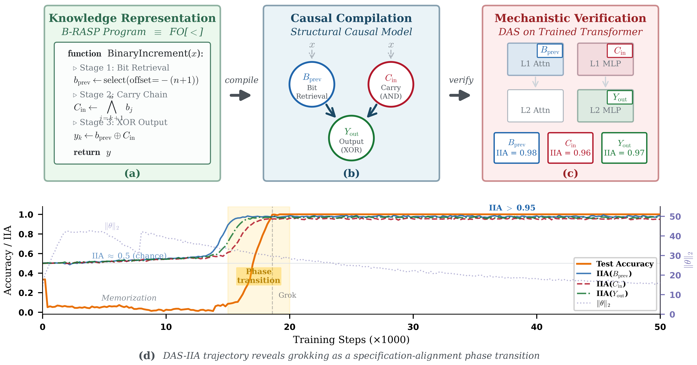

<div align="center">

# 🔍 KR-Guided Mechanistic Verification

**Bridging Knowledge Representation and Mechanistic Interpretability**

*Compiling B-RASP specifications into testable causal hypotheses for Transformer networks*

[](https://www.python.org/downloads/)
[](https://pytorch.org/)
[](LICENSE)

<br>



</div>

---

## Overview

This repository implements a framework that **compiles B-RASP programs** — formal specifications of Transformer computation — into **Structural Causal Models (SCMs)**, then uses **Distributed Alignment Search (DAS)** and **Sparse Autoencoders (SAEs)** to verify whether trained Transformers faithfully realize the prescribed computation.

We demonstrate the framework on *n*-bit binary **increment** and **decrement**:

| Finding | Detail |
|---------|--------|
| 🧮 **Succinctness separation** | 2-layer Transformer groks to perfect accuracy at *n* = 8–24; all parameter-matched recurrent/SSM baselines fail exponentially |
| 🎯 **Causal alignment** | DAS yields IIA > 0.95 for all three B-RASP variables at the predicted components |
| 🔬 **SAE convergence** | Monosemantic features (cos > 0.83 with DAS directions) recovered from *D* = 1,024 dictionary features |
| 📈 **Phase transition** | Specification conformance emerges as a sharp sigmoid during grokking — finer-grained than weight norm |
| 🔄 **Generalization** | Full pipeline replicates on binary decrement with cross-task double dissociation |

---

## 🏗️ Project Structure

```
kr-mechanistic-verification/
├── configs/
│   └── default.yaml                # All hyperparameters (model · training · DAS · SAE)
├── src/
│   ├── data/
│   │   └── binary_arithmetic.py    # Dataset: n-bit increment & decrement
│   ├── models/
│   │   ├── transformer.py          # Decoder-only Transformer (ℓ=2, H=2, d=128)
│   │   └── baselines.py            # LSTM, GRU, Mamba (parameter-matched)
│   ├── verification/
│   │   ├── scm.py                  # B-RASP → SCM compilation
│   │   ├── das.py                  # Distributed Alignment Search + IIA
│   │   └── sae.py                  # TopK Sparse Autoencoder + feature alignment
│   └── utils/
│       └── metrics.py              # Per-seq accuracy, IIA, weight norm
├── scripts/
│   ├── train.py                    # Train Transformer & baselines with grokking
│   ├── verify_das.py               # DAS verification pipeline
│   ├── verify_sae.py               # SAE cross-validation pipeline
│   └── run_ablations.py            # Depth · weight decay · subspace dim ablations
├── figures/
│   ├── generate_all_figures.py     # Main-text + appendix figures (7 figures)
│   └── figure1_pipeline.py         # Figure 1 composite panel
├── requirements.txt
└── LICENSE
```

---

## 🚀 Quick Start

### Installation

```bash
git clone https://github.com/<your-handle>/kr-mechanistic-verification.git
cd kr-mechanistic-verification
pip install -r requirements.txt
```

### Train → Verify → Visualize

```bash
# 1. Train Transformer on 16-bit increment (5 seeds)
python scripts/train.py --task increment --n 16 --seeds 5

# 2. DAS verification
python scripts/verify_das.py --task increment --n 16 --seeds 5

# 3. SAE cross-validation
python scripts/verify_sae.py --task increment --n 16 --seeds 5

# 4. Reproduce all figures
python figures/generate_all_figures.py
```

---

## ⚙️ Configuration

All hyperparameters are centralized in [`configs/default.yaml`](configs/default.yaml) and match the paper exactly.

<details>
<summary><b>🏛️ Model Architecture</b></summary>

| Parameter | Value | Notes |
|-----------|-------|-------|
| Layers ℓ | 2 | Minimum for 3-stage B-RASP |
| Heads H | 2 | Per layer |
| Hidden dim *d* | 128 | Standard grokking config |
| MLP dim | 4*d* = 512 | GELU activation, bias in both layers |
| Norm | Pre-norm LN | ε = 1e-5 |
| Positional enc. | Learned | T_max = 49 |
| Dropout | 0 | Weight decay only |
| Vocab | 3 | {`0`, `1`, `#`} |
| Output head | Linear, no bias | No weight tying |
| Init | Kaiming uniform | PyTorch defaults |
| Total params | **403,840** | — |

</details>

<details>
<summary><b>🏋️ Training</b></summary>

| Parameter | Value |
|-----------|-------|
| Optimizer | AdamW (β₁=0.9, β₂=0.98, λ=1.0) |
| Learning rate | 1e-3 → cosine decay to 0 |
| Warmup | 500 steps (linear) |
| Batch size | 512 |
| Gradient clipping | None |
| Total steps | 100,000 |
| Train fraction α | 0.5 |
| Seeds | 5 (independent) |
| Checkpoints | Every 200 steps (50 near transition) |

</details>

<details>
<summary><b>🔍 DAS</b></summary>

| Parameter | Value |
|-----------|-------|
| Subspace dim *r* | 1 |
| Components | L1-attn, L1-MLP, L2-attn, L2-MLP |
| Optimizer | Adam (β₁=0.9, β₂=0.999, lr=1e-3) |
| Epochs | 10 (saturates by 5) |
| Base–source pairs | 2,000 train / 1,000 eval |
| Trajectory | Re-train *R* at each of *C* = 500 checkpoints |

</details>

<details>
<summary><b>🧬 SAE</b></summary>

| Parameter | Value |
|-----------|-------|
| Architecture | TopK |
| Dict size *D* | 8*d* = 1,024 |
| Sparsity *K* | 8 |
| Optimizer | Adam (lr=3e-4) |
| Batch / Epochs | 256 / 50 |
| Activations | 20,000 forward passes |
| Monosemantic | \|ρ\| > 0.9 ∧ acc > 0.95 |
| DAS–SAE convergence | cos > 0.8 |

</details>

---

## 📊 Key Results

### Generalization & Succinctness (Table 1)

| Model | Params | n=8 | n=16 | n=24 |
|-------|--------|-----|------|------|
| **Transformer** (ℓ=2) | 403,840 | **1.00** | **1.00** | **1.00** |
| LSTM | 400,957 | .71 | .07 | .01 |
| GRU | 402,483 | .65 | .05 | .01 |
| Mamba | 403,674 | .68 | .06 | .01 |

### DAS Verification at n=16 (Table 2a)

| Variable | Best Component | IIA |
|----------|---------------|-----|
| B_prev | L1-attn | **.98** ± .01 |
| C_in | L1-MLP | **.96** ± .02 |
| Y_out | L2-MLP | **.97** ± .01 |

### SAE Feature Alignment at n=16 (Table 4)

| Variable | Feature | \|ρ\| | Accuracy | cos(DAS, SAE) |
|----------|---------|-------|----------|---------------|
| B_prev | z₃₇ | .94 | .97 | .87 |
| C_in | z₁₄₂ | .93 | .96 | .83 |
| Y_out | z₈₉ | .96 | .98 | .91 |

### IIA Trajectory Phases (n=16)

```
Phase 1  Random           (steps 0–1,800)          IIA_min ≈ 0.50
Phase 2  Memorization     (steps 1,800–12,500)     IIA_min ≈ 0.50–0.56
Phase 3  Phase transition (steps 12,500–18,600)    IIA_min  0.56 → 0.96  (sigmoid)
Phase 4  Stable alignment (steps 18,600+)          IIA_min ≈ 0.96
```

---

## 🧪 Reproducing All Experiments

### Full scaling sweep (Tables 1 & 3)

```bash
for n in 8 12 16 20 24; do
    python scripts/train.py --task increment --n $n --seeds 5
    python scripts/verify_das.py --task increment --n $n --seeds 5
done
```

### Architecture ablations

```bash
# Depth ablation: ℓ ∈ {1, 2, 3}
python scripts/run_ablations.py --type depth --n 16

# Weight decay ablation: λ ∈ {0, 0.1, 1.0}
python scripts/run_ablations.py --type weight_decay --n 16

# Subspace dimension: r ∈ {1, 2, 4, 8}
python scripts/run_ablations.py --type subspace_dim --n 16
```

### Binary decrement replication (Appendix B)

```bash
for n in 8 16 24; do
    python scripts/train.py --task decrement --n $n --seeds 5
    python scripts/verify_das.py --task decrement --n $n --seeds 5
    python scripts/verify_sae.py --task decrement --n $n --seeds 5
done

# Cross-task controls
python scripts/run_ablations.py --type cross_task --n 16
```

### Figures

```bash
python figures/generate_all_figures.py    # All 7 figures at DPI=1200
python figures/figure1_pipeline.py        # Figure 1 composite panel
```

---

## 📁 Checkpoint Format

```python
{
    "model_state_dict": ...,
    "optimizer_state_dict": ...,
    "step": int,
    "config": dict,                # Full hyperparameters
    "metrics": {
        "train_seq_acc": float,    # Per-sequence train accuracy
        "test_seq_acc": float,     # Per-sequence test accuracy
        "weight_norm": float,      # ||θ||_2
    }
}
```

---

## Dependencies

```
torch >= 2.0
numpy >= 1.24
matplotlib >= 3.7
pyvene >= 0.1       # causal intervention library
pyyaml >= 6.0
scipy >= 1.10
tqdm >= 4.65
```

---

## License

MIT License. See [LICENSE](LICENSE) for details.
